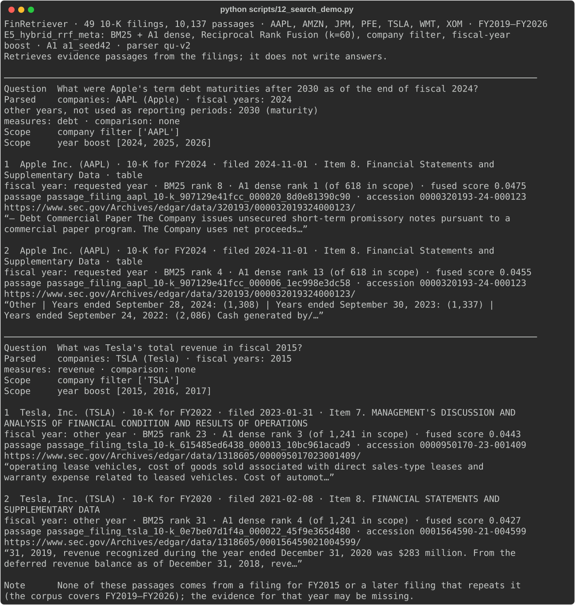
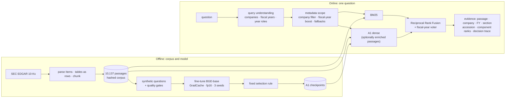

# FinRetriever

[](https://github.com/msheikh9/FinRetriever/actions/workflows/ci.yml)

[](LICENSE)

**Evidence retrieval for financial research questions over SEC 10-K filings.**

FinRetriever finds the passages in annual reports that answer an analyst's question, such as "How much long-term
debt did Walmart report at the end of fiscal 2023?". For every passage it returns, it shows where the passage comes
from: company, filing, fiscal year, section and SEC accession number. It combines three things:

- a fine-tuned dense retriever;
- BM25;
- a metadata-aware hybrid pipeline that reads which companies and fiscal years a question is about.

Every stage, from the EDGAR download to the result tables, records what it read and produced. The experiments
re-run byte for byte.



<sub>Actual output of `scripts/12_search_demo.py` with the release default (E5, which needs the A1 checkpoints),
rendered to SVG. In the first question, 2030 is recognised as a debt-maturity year and is not used to choose
filings. The second question asks for a year the corpus does not cover, and the demo says so instead of presenting
other years as the answer. More in [docs/demo.md](docs/demo.md).</sub>

**Contents:** [Highlights](#highlights) · [Why it's hard](#why-financial-document-retrieval-is-hard) ·
[Architecture](#architecture) · [Fine-tuning](#three-seed-bge-fine-tuning) ·
[Infrastructure](#reproducible-training-infrastructure) · [Hybrid retrieval](#bm25-and-dense-hybrid-retrieval) ·
[Metadata-aware retrieval](#metadata-aware-retrieval-company-and-fiscal-year-grounding) ·
[Results](#experimental-results) · [Demo](#working-demonstration) ·
[Installation](#installation-and-reproducibility) · [License](#license) ·
[Limitations](#limitations-and-future-work) · [Human evaluation](#human-relevance-evaluation)

## Highlights

1. **Financial document retrieval.** The corpus is 49 SEC 10-K filings: 7 companies across sectors, fiscal years
   2019–2026, 10,137 passages. Tables are kept as labelled rows. Every result traces back to its filing.
2. **Three-seed BGE fine-tuning.** `BAAI/bge-base-en-v1.5` was fine-tuned three times (seeds 42, 1337 and 2026) on
   678 leakage-checked synthetic question–passage pairs. Each checkpoint was chosen by a rule fixed in advance. A
   test registered in advance finds that the fine-tuned model beats its base model on the synthetic validation
   set (p = 0.0001).
3. **Reproducible training infrastructure.**
   - GradCache, for exact large-batch gradients on a 16 GB GPU; the tests check exactness in float64.
   - fp16 mixed precision.
   - Hashed inputs and verified checkpoints.
   - Evaluation-isolation checks before scoring.
   - Pinned environments and byte-identical re-runs.
4. **BM25 and dense hybrid retrieval.** Reciprocal Rank Fusion of BM25 and the fine-tuned model. Together the two
   find the relevant passage for 90–91 of the 93 validation questions.
5. **Metadata-aware retrieval.** A company filter, a fiscal-year boost that also covers the later 10-Ks repeating
   a year, company-year result slots, metadata-enriched embeddings, and token windows for long passages.
6. **Fiscal-year and company grounding.**
   - The query parser reads companies and fiscal years, and tells reporting years apart from target, maturity,
     historical and incidental years ("notes due 2030", "by 2025 compared to 2016").
   - On 100 human-written questions, measured once after the parser was frozen (version qu-v1), it named the right
     companies for 99 and the right fiscal years for all 100. The current version reads them identically.
7. **Experimental results.** The release default lifts MRR@10 on the 93 synthetic validation questions from 0.665
   to 0.851 (p ≤ 0.0001 in each of the three seeds). For 92.3% of the 100 real questions, its top result comes from
   the asked company and year, against 21.0% for the fine-tuned model alone. These are synthetic and metadata
   measures, not human relevance labels (see [Limitations](#limitations-and-future-work)).
8. **Working demonstration.** A command-line search shows the parsed scope, every decision, and evidence that
   traces back to EDGAR. A mode without checkpoints runs on public data alone.
9. **Installation and reproducibility.**
   - `make install-locked` installs the tested environment.
   - 1,287 tests pass in a fresh clone.
   - CI runs in the pinned environment.
   - The corpus rebuilds from EDGAR to the exact published SHA-256.

## Why financial document retrieval is hard

General-purpose retrievers confuse filings that look alike. The [v1 retrieval analysis](docs/retrieval_analysis_v1.md)
and the [v2 experiments](docs/retrieval_v2_metadata_hybrid.md) measured how:

- **The same line items appear in every company's and every year's filing.** A question about Apple's FY2022
  long-term debt competes with ExxonMobil's, Walmart's and JPMorgan's long-term-debt notes, and with Apple's own
  other years.
- **Company identity is often missing from the text:** **59%** of passages never name their company. In 405 of the
  678 training pairs, the question names the company but the positive passage does not.
- **The fiscal year sits in column headers, and later filings repeat earlier years** as comparative columns.
  Within the right company, BM25 and zero-shot BGE pick the asked year no more often than chance (16–18%, against
  17.6%).
- **Questions mention years that are not reporting periods.** Thirteen of the 771 training and validation
  questions contain such a year, and a hard year filter removed every relevant passage for one of them.
- **Passages are long:** 91% exceed the encoder's 512-token window, so 28% of passage text is never encoded.

## Architecture



| Package | Responsibility |
|---|---|
| `finretriever.data` | EDGAR download (optionally pinned to exact filings), filing parser, chunker, corpus manifest, record schemas |
| `finretriever.training` | Data preparation, synthetic question generation and quality gates, the bi-encoder trainer (GradCache, fp16), checkpoint selection, the A0-vs-A1 decision rule |
| `finretriever.retrieval` | BM25, dense retrieval, checkpoint loading, embedding cache; query understanding, metadata scope, fusion, the hybrid retriever, enrichment, windows |
| `finretriever.evaluation` | Metrics, benchmark harness, evaluation isolation, bootstrap and sign-flip uncertainty, the metadata-alignment diagnostic |

The full design is in [docs/architecture.md](docs/architecture.md).

## Three-seed BGE fine-tuning

**A1** is a procedure: fine-tune BGE-base on the 678 verified training pairs, then select a checkpoint by a fixed
rule. **A0** is the same model at step 0.

- **Training data:** questions written by an LLM for approved passages. Each passes quality gates before use:
  - grounding of the quoted evidence;
  - semantic screening against the evaluation questions;
  - evidence reuse across filings;
  - leakage-safe splits.
- **Training run:** a Kaggle T4, contrastive loss with in-batch negatives, GradCache (batches of up to 64 pairs,
  encoded in mini-batches of 16), fp16 autocast with a GradScaler, learning rate 2e-5, 55 steps.
- **Selection rule:** every 5 steps, the checkpoint is scored by whole-corpus MRR@10 on the 93 validation
  questions. Ties go to the earlier step.

| | A0 (step 0) | Seed 42 | Seed 1337 | Seed 2026 |
|---|---:|---:|---:|---:|
| Selected step | — | 55 | 40 | 40 |
| Validation MRR@10 (whole corpus) | 0.266 | 0.669 | 0.667 | 0.658 |
| Validation Recall@100 | 0.837 | 1.000 | 0.997 | 1.000 |

The decision rule, a selection-aware sign-flip test over the three seeds, was registered in advance. It found
**"A1 beats A0 on the validation set"**: p = 0.0001, with a selection-adjusted effect of +0.365 MRR@10
([a1_three_seed_summary.md](docs/a1_three_seed_summary.md)). These questions are synthetic, come from the training
distribution and also chose the checkpoints, so the effect is an upper bound.

## Reproducible training infrastructure

- **GradCache is tested as exact.**
  - In float64, it must match plain full-batch training to within 1e-12 of the largest gradient.
  - A float32 test checks that its rounding error is of the same size as plain training's, within a factor of four.
  - Why the tests run in float64: [ci_gradcache_investigation.md](docs/ci_gradcache_investigation.md).
- **Every input is hashed.**
  - The corpus, training pairs, validation set, configs and question exports are checked against their SHA-256
    before use.
  - Each training run records its environment and audits its outputs (audits for seeds
    [42](docs/seed42_final_audit.md), [1337](docs/seed1337_final_audit.md) and [2026](docs/seed2026_final_audit.md)).
- **Checkpoints are verified, not trusted.**
  - Before a model is loaded, its files are hashed and its selection record is checked.
  - The selected checkpoints reproduce their recorded validation ranks on a different machine: 89–93 of 93
    first-relevant ranks are identical, and the rest are one rank apart.
- **Evaluation isolation.** Before a fine-tuned model is scored, the harness checks from files that no evaluation
  passage or question reached its training data.
- **Embedding caches** are keyed by the corpus, model, revision and every encoding setting. A mismatch is an
  error, never a silent rebuild.
- **Experiments never overwrite each other.**
  - Each suite has its own config and output directory.
  - Its manifest records the config hash, input hashes, checkpoint digests, cache keys, source-file hashes and
    library versions.
  - A follow-up run (v2.1) is compared question by question with the frozen earlier run (v2).
- **Deterministic outputs.** No timestamps are written, and repeated runs are byte-identical. Re-running the v2
  experiments with the current code reproduces all 220 result files exactly.

## BM25 and dense hybrid retrieval

The [v1 analysis](docs/retrieval_analysis_v1.md) compared single retrievers and found them complementary:
- Each finds relevant passages that the other misses; together they cover 90–91 of the 93 validation questions.
- A1 is more year-aware but less company-aware than its base model.

**Reciprocal Rank Fusion** combines the two rankings. Fusion alone is mixed: higher on validation (not
significant), lower on development nDCG@10. Its value appears with the metadata scope below, where a fiscal-year
ranking joins the fusion as one more voter (`finretriever.retrieval.fusion`, `hybrid`).

## Metadata-aware retrieval: company and fiscal-year grounding

v2 turns the v1 findings into a retrieval pipeline without retraining the model
([docs/retrieval_v2_metadata_hybrid.md](docs/retrieval_v2_metadata_hybrid.md)).

1. **Query understanding.**
   - A deterministic parser reads:
     - the companies (ticker, registered name, aliases);
     - the fiscal years (`FY2024`, `fiscal 2024`, period-end dates, ranges, "2023 versus 2022");
     - the financial measures and the comparison type.
   - Every year gets a **role**. Only fiscal (reporting) years shape the search. Target, maturity, historical and
     incidental years ("by 2030", "notes due 2030", "since 2015", "the 2018 CEO Performance Award") are recorded
     but not used.
   - When it is unsure, it applies no constraint.
2. **Metadata scope.**
   - A company filter.
   - A fiscal-year **boost**. It also covers the two later 10-Ks, which repeat the year in their comparative
     columns.
   - The boost is the default rather than a hard filter, because a filter drops evidence whenever a year is misread.
   - Optional company-year slots give each company and year in a comparison its own results.
3. **Metadata-enriched embeddings.** A company, fiscal-year and section header is added at encoding time. The corpus
   is never changed.
4. **Long passages.** Token windows cover text past the 512-token limit, and each passage takes its best window's
   score.

**Release default** (`E5_hybrid_rrf_meta`): BM25 + A1 fused by RRF, a company filter, a fiscal-year boost, and
parser qu-v2.

## Experimental results

**Evaluation sources.** None of the three is an independent human relevance benchmark
([methodology](docs/eval_methodology.md)).

| Source | Questions | What it can show | What it cannot show |
|---|---:|---|---|
| Validation (`validation_pairs_v4`) | 93 | Rank metrics against one labelled positive plus its exact equivalents | Independence: the questions are synthetic, come from the training distribution, chose the A1 checkpoints and informed the fiscal-year window |
| Development (`dev_pilot_v3`) | 10 | Metrics against graded labels | Precision: the labels are AI-written, and passages not in the pools count as non-relevant |
| Real questions (gold set v1) | 100 | Whether each top 10 comes from the asked companies and years; parser accuracy | Relevance: there are no relevance labels |

Every metric has a question-level 95% bootstrap interval. Comparisons use paired bootstraps and sign-flip tests,
and primary settings were fixed before results were computed. The development labels and the human-annotation
records name project contributors, so they are kept in the project's private archive. The results computed from
them (metrics and passage IDs) are in `results/`.

**v1: single retrievers**

| System | Validation MRR@10 | Development MRR@10 | Real questions: top 10 from the asked company / fiscal year |
|---|---:|---:|---:|
| BM25 | 0.635 | 0.323 | 78.7% / 12.4% |
| BGE zero-shot (= A0) | 0.266 | 0.550 | 94.6% / 16.8% |
| `intfloat/e5-base-v2` zero-shot | 0.402 | 0.600 | 94.1% / 26.4% |
| A1 (three seeds) | 0.658–0.669 | 0.558–0.667 | 82.2–83.0% / 20.5–23.1% |

**v2: one change at a time** (means over the three A1 seeds; parser qu-v1)

| Experiment | Validation MRR@10 | Development MRR@10 | Development Recall@10 | Real questions: top 10 from the asked company / fiscal year |
|---|---:|---:|---:|---:|
| E1 · A1 dense (baseline) | 0.665 | 0.603 | 0.304 | 82.7% / 21.6% |
| E2 · + company filter | 0.729 | 0.642 | 0.332 | 100.0% / 26.3% |
| E3b · + company and fiscal-year filters | 0.740 | 0.675 | 0.372 | 100.0% / 53.8% |
| E4 · BM25 + A1 (RRF) | 0.718 | 0.602 | 0.278 | 82.4% / 17.9% |
| E5 · RRF + company filter + fiscal-year boost | 0.842 | 0.642 | 0.375 | 100.0% / 48.7% |
| E6 · A1 on enriched passages | 0.749 | 0.635 | 0.382 | 93.6% / 31.3% |
| E7 · combined (pre-registered) | 0.814 | 0.676 | 0.398 | 100.0% / 55.0% |
| E8 · A1 + tail windows | 0.660 | 0.601 | 0.369 | 83.3% / 22.8% |

**v2.1: fiscal-year roles** (parser qu-v2; [details](docs/retrieval_v2_metadata_hybrid.md#v21-fiscal-year-roles-parser-qu-v2))

| Experiment | Validation MRR@10, v2 → v2.1 | Validation Recall@100, v2 → v2.1 |
|---|---:|---:|
| E3b · company and fiscal-year filters | 0.740 → 0.746 | 0.951 → 0.962 |
| **E5 · release default (boost)** | **0.842 → 0.851** | 0.994 → 0.994 |
| E7 · combined (hard filter) | 0.814 → 0.825 | 0.951 → 0.962 |

What held up in all three seeds:
- **Company scoping:** +0.064 validation MRR@10 (p ≤ 0.0001), with no question worse. The parser named the right
  companies for 99 of the 100 real questions.
- **Fusion with a fiscal-year boost (E5):** the largest validation gain, +0.186 over the baseline in v2.1
  (p ≤ 0.0001), at Recall@100 0.994. For 92.3% of the real questions the top result comes from the asked company
  and year (baseline: 21.0%).
- **Passage enrichment without retraining:** on the real questions, the share of A1's top 10 from other companies
  falls from 17.3% to 6.4%.
- **Company-year slots:** cross-company questions with every company-year in the top 10 rise from 0–1 of 10 to
  7–8 of 10. This is metadata coverage, not relevance.
- **Year roles (v2.1):** they fix the one validation question a hard filter lost entirely ("by 2025 compared to
  2016 levels"). Before, the filter left it with no relevant passage at all; now one ranks 1st or 2nd. Nothing else
  moves: one question cannot be significant, and the development and real questions parse identically.

What did not hold up:
- **A hard fiscal-year filter** still drops evidence that repeats in filings outside the year window (Recall@100
  0.962), so it is not the default.
- **BM25 + A1 fusion alone** is mixed.
- **Tail windows** have no net effect: they help late evidence and hurt early evidence.

On the 10 development questions, no primary experiment's MRR@10 difference is significant (smallest p 0.50).
The v2.1 development rankings are identical to v2's.

## Working demonstration

`scripts/12_search_demo.py` takes a question and shows:
- what the parser read, including any years it set aside;
- each scope decision;
- the top passages, with company, form, fiscal year, filing date, section, the passage's rank in BM25 and in the
  dense model, passage ID, accession number and EDGAR address.

It never writes an answer: when the requested year is not covered, it says the evidence may be missing.

```text
Question  How much long-term debt did Walmart report at the end of fiscal 2023?
Parsed    companies: WMT (Walmart) · fiscal years: 2023
          measures: debt · comparison: none
Scope     company filter ['WMT']
Scope     year boost [2023, 2024, 2025]
 …
 2  Walmart Inc. (WMT) · 10-K for FY2023 · filed 2023-03-17 · Item 7. MANAGEMENT'S DISCUSSION AND
    ANALYSIS OF FINANCIAL CONDITION AND RESULTS OF OPERATIONS · table
    fiscal year: requested year · BM25 rank 21 · A1 dense rank 1 (of 1,010 in scope) · fused score 0.0449
    passage passage_filing_wmt_10-k_3bd870054668_000020_80173a63e4f0 · accession 0000104169-23-000020
    https://www.sec.gov/Archives/edgar/data/104169/000010416923000020/
    “of January 31, 2023, we have $2.1 billion of syndicated and fronted letters of credit
    available, of which $1.8 billion was drawn and represents an unrecorded current obligation.
    Long-term Debt The fol…”
```

The demo shows evidence as it is: in this run, the first hit is a segment table without the debt figure, and the
debt passages come second and third. [docs/demo.md](docs/demo.md) has the full output and the setup.

## Installation and reproducibility

FinRetriever is tested on **Python 3.11**.

```bash
git clone https://github.com/msheikh9/FinRetriever.git && cd FinRetriever
python3.11 -m venv .venv && source .venv/bin/activate
make install-locked      # the pinned, tested environment (macOS arm64 or Linux x86_64 CPU lock)
make test                # the full test suite; no data or model download needed
```

[docs/environment.md](docs/environment.md) covers GPU installs, `pip install -e ".[dense,dev]"` and other platforms.

**Run the demo from a fresh clone.** The corpus is not in git. Rebuild it from SEC EDGAR, pinned to the exact 49
filings: about 270 MB to download, and several minutes to build.

```bash
export SEC_USER_AGENT="Your Name your.email@example.com"   # the SEC requires a contact in the User-Agent
make download CORPUS_CONFIG=configs/data/corpus_v1_pinned.yaml
make corpus CORPUS_CONFIG=configs/data/corpus_v1_pinned.yaml
shasum -a 256 data/processed/corpus_v1.jsonl                  # ff9dadf37bb9820e…, the published corpus

python scripts/12_search_demo.py --config configs/demo/public_bm25.yaml \
    --question "How much long-term debt did Walmart report at the end of fiscal 2023?"
```

- **The no-checkpoint mode** uses BM25 with the same metadata-aware scope. It was not evaluated.
- **The evaluated release default** needs the fine-tuned A1 checkpoints under `models/`. They are not published
  yet. With them, the dense embeddings are computed on the first run (tens of minutes on a laptop CPU) and cached:

  ```bash
  python scripts/12_search_demo.py --question "..."
  ```

**Pipeline.** Each step is a script with a YAML config.

| Step | Command | Needs |
|---|---|---|
| Download and build the corpus | `make download`, `make corpus` (`CORPUS_CONFIG=configs/data/corpus_v1_pinned.yaml` for the exact corpus) | `SEC_USER_AGENT` ([data pipeline](docs/data_pipeline.md)) |
| Training data | `python scripts/02_generate_queries.py ...` | A Groq API key; spends tokens ([training data](docs/training_data_v3.md)) |
| Fine-tune | `python scripts/05_train_biencoder.py ...` | A GPU; bundles for Kaggle ([Kaggle training](docs/kaggle_training.md)) |
| v1 analysis | `python scripts/09_retrieval_analysis.py` | The corpus, checkpoints and validation set |
| v2 and v2.1 experiments | `python scripts/11_v2_experiments.py [--config configs/experiments/v2_1_year_roles.yaml]` | The same; `--prepare-only` builds the embedding caches |
| Search demo | `python scripts/12_search_demo.py --question "..."` | The corpus, plus the checkpoints for the default retriever |

**Testing.**
- **A fresh clone:** 1,287 tests pass and 42 skip. The skipped tests need the raw 10-K filings (`make download`
  fetches them, and the per-filing layout tests then run as well) or training data that is not in this repository.
  In the full development environment, 1,588 tests pass.
- **CI** runs ruff and the suite on Linux in the pinned environment, offline (`.github/workflows/ci.yml`).
- **Coverage includes:**
  - EDGAR parsing, chunking and filing pinning;
  - leakage checks, the trainer and GradCache exactness;
  - checkpoint verification;
  - retrieval determinism, and RRF checked against an independent computation;
  - 29 year-role parser cases;
  - metadata scoping, and an end-to-end hybrid retrieval test.

## License

The code is MIT-licensed (see [LICENSE](LICENSE)). The licences and terms for the base model, SEC filing text, the
synthetic training data and the dependencies are in [docs/licensing_and_permissions.md](docs/licensing_and_permissions.md).
This repository does not redistribute the SEC corpus, the fine-tuned checkpoints or the synthetic training data:
the corpus is rebuilt from EDGAR with the pinned configuration.

## Limitations and future work

- **Scope:**
  - seven companies, 49 10-K filings, English only;
  - no 10-Q or 8-K filings, and no other markets.
- **Model:**
  - A1 was trained on 678 synthetic pairs from one LLM.
  - Enrichment and windows are applied at inference only; the model was not retrained with them.
  - The fine-tuned checkpoints are not published yet.
- **Query parser:**
  - It is rule-based. It recognises company names, tickers and configured aliases, but not subsidiaries or
    segments such as "Sam's Club".
  - Year roles need a cue next to the year. Without one, a year is read as a fiscal year.
- **Evaluation evidence:**
  - The validation questions are synthetic, come from the same generator as the training data, and selected the
    checkpoints. They also informed v2's fiscal-year window.
  - The development set has 10 questions with AI-written labels.
  - The real-question results are a metadata diagnostic: when the parser is right, a scoped system aligns with
    the asked company and year by construction.
- **Future work:**
  - a small, complete human-labelled evaluation set with two annotators, as the gating step for any quality claim;
  - retraining A1 on enriched, encoder-sized passages with hard negatives from the same company's other years;
  - a cross-encoder reranker;
  - an external financial retrieval benchmark ([research_readiness.md](docs/research_readiness.md)).

### Human relevance evaluation

- 100 human-written financial research questions were prepared.
- The human relevance annotation was closed as an incomplete pilot. 45 human judgments, all for one question,
  were officially imported.
- The complete human relevance benchmark and the independent annotator-agreement study were not completed.
- Consequently, **no independent human-relevance improvement claim is made** for A1 or for v2.
