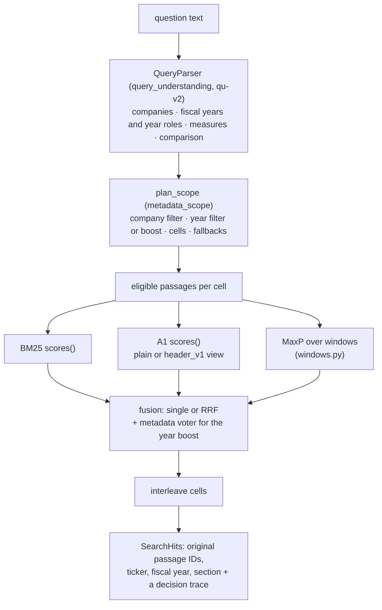

# FinRetriever architecture

FinRetriever retrieves evidence passages from SEC 10-K filings for financial research questions. This document
describes how the system is built: the data pipeline, the training pipeline, the retrievers (v1 and the v2
metadata-aware hybrid), the evaluation stack and the integrity guarantees that run through all of them.

## 1. The system at a glance

```mermaid
flowchart LR
  subgraph Data["Data (src/finretriever/data)"]
    A[SEC EDGAR] -->|edgar_downloader| B[raw 10-K filings]
    B -->|filing_parser| C[Item sections, tables as rows]
    C -->|chunker, corpus_builder| D[(corpus_v1@1.2<br/>10,137 passages)]
  end
  subgraph Train["Training (src/finretriever/training)"]
    D --> E[blocklist, overlap groups, splits]
    E -->|query_generation via Groq| F[synthetic questions]
    F -->|pair_quality, semantic_screen, evidence_reuse| G[(train_candidates_v3: 678<br/>validation_pairs_v4: 93)]
    G -->|biencoder_trainer: GradCache, Kaggle T4| H[checkpoints every 5 steps]
    H -->|checkpoint_selection: fixed rule| I[(A1: seeds 42, 1337, 2026)]
  end
  subgraph Retrieve["Retrieval (src/finretriever/retrieval)"]
    D --> J[BM25]
    D --> K[dense bi-encoder<br/>+ embedding cache]
    I --> K
    Q[question] --> P[query understanding]
    P --> S[metadata scope]
    J --> R[rank fusion]
    K --> R
    S --> R
    R --> T[ranked passages<br/>with filing metadata]
  end
  subgraph Eval["Evaluation (src/finretriever/evaluation)"]
    T --> U[metrics, uncertainty,<br/>alignment diagnostic]
  end
```

| Package | Responsibility | Key modules |
|---|---|---|
| `data` | Download, parse and chunk 10-K filings into passages; the shared record schemas | `edgar_downloader`, `filing_parser`, `chunker`, `corpus_builder`, `schemas` |
| `training` | Leakage-safe training data, synthetic question generation and quality gates, contrastive fine-tuning, checkpoint selection and the A0-vs-A1 decision rule | `data_prep`, `blocklist`, `splits`, `query_generation`, `pair_quality`, `semantic_screen`, `evidence_reuse`, `trainer_setup`, `biencoder_trainer`, `checkpoint_selection`, `decision_rule` |
| `retrieval` | Retrievers and the v2 pipeline | `base`, `bm25`, `biencoder`, `checkpoint`, `embedding_cache`, `query_understanding`, `metadata_scope`, `fusion`, `hybrid`, `enrichment`, `windows` |
| `evaluation` | Metrics, benchmark harness, isolation and provenance checks, uncertainty, the alignment diagnostic | `metrics`, `benchmark`, `isolation`, `provenance`, `exclusion`, `stored_runs`, `uncertainty`, `alignment`, `gold_decision` |
| `eval_set` | Building and auditing evaluation questions, pools and labels (development labels, the gold-set tooling) | `annotation_cli`, `annotation_store`, `dev_pool`, `dev_labels`, `qrels_builder`, ... |

## 2. Data: from EDGAR to passages

- **Corpus scope:** seven companies across sectors (AAPL, AMZN, JPM, PFE, TSLA, WMT, XOM), seven 10-Ks each
  (fiscal years 2019–2026 by period end), downloaded from the official EDGAR endpoints with a declared user agent and
  rate limiting (`configs/data/corpus_v1.yaml`).
- **Parsing:** each filing is split into its Items. Tables are rendered as self-describing rows (`label | column:
  value`), so a figure keeps its row and column labels.
- **Chunking:** sections are cut into passages of up to 512 whitespace tokens with an 80-token overlap. A passage
  never spans two Items, and table rows are never split. Passage IDs are deterministic.
- **Record schemas** (`data/schemas.py`, strict, `extra="forbid"`): `Filing`, `Section`, `Passage`, `Query`, `Qrel`
  and `SearchHit`. Each passage carries the filing's ticker, registered company name, form, filing date and
  period-end date (from which the fiscal year is derived), the Item number and section title, and a table flag.
- **Identity:** the corpus build writes a manifest with the corpus SHA-256 (`ff9dadf3…`). Every later stage checks
  that hash before it reads a passage.

## 3. Training: A1, three seeds

The fine-tuned model **A1** is defined as a procedure: fine-tune `BAAI/bge-base-en-v1.5` (pinned revision) on the
verified training pairs, then select a checkpoint by a fixed validation rule. **A0** is its unmodified step 0.

1. **Leakage-safe data** (`data_prep`, `blocklist`, `splits`): evaluation passages are blocklisted, near-duplicate
   passages are grouped, and train/validation splits are made by group.
2. **Synthetic questions** (`query_generation`): an LLM (through Groq's API) writes analyst-style questions for
   approved passages. Each question passes quality gates: grounding of the quoted evidence (`quotes`), pair checks
   (`pair_quality`), a semantic screen against the evaluation questions (`semantic_screen`), and evidence reuse
   across filings, which records which other passages state the same fact (`evidence_reuse`).
3. **Frozen datasets:** `train_candidates_v3` (678 pairs) and `validation_pairs_v4` (93 questions), each with a
   manifest of hashes.
4. **Training** (`biencoder_trainer`):
   - contrastive loss with in-batch negatives, GradCache (exact gradients at batch 64 on a 16 GB T4), fp16 and
     dropout replay;
   - balanced batches;
   - a checkpoint every 5 steps.

   It ran on Kaggle T4 GPUs from verified bundles (`smoke_bundle`, `smoke_preflight`), with three seeds (42, 1337,
   2026).
5. **Selection** (`checkpoint_selection`): a fixed rule (whole-corpus MRR@10 on the validation questions; ties to
   the earlier step; patience 3) writes a write-once `selection.json`. The selected checkpoints are steps 55, 40 and
   40.
6. **Decision** (`decision_rule`, `scripts/07`): a selection-aware sign-flip test of A1 against A0 over the three
   seeds.

Details: [training_full_v1.md](training_full_v1.md), [kaggle_training.md](kaggle_training.md),
[a1_three_seed_summary.md](a1_three_seed_summary.md) and the per-seed audits.

## 4. Retrieval

### 4.1 v1 retrievers

- **`BaseRetriever`** (`retrieval/base.py`) is a protocol: `index`, `search` and `batch_search`.
  - `eligible_indices` and `rank_top_k` apply a company restriction before ranking, never by filtering a global
    top k.
  - Ties are broken by corpus position, so the same inputs always give the same ranking.
- **BM25** (`retrieval/bm25.py`): a deterministic pure-Python engine. The word tokenizer keeps figures such as
  `1,200` whole.
- **Dense** (`retrieval/biencoder.py`): any sentence-transformers model at a pinned commit, with:
  - the model's own query and passage prefixes;
  - L2-normalised embeddings scored by cosine in float64;
  - truncation statistics recorded.
- **Checkpoints** (`retrieval/checkpoint.py`):
  - a local trainer checkpoint is inspected, its files are hashed, and its selection record is verified before
    the model is loaded;
  - the encoder is rebuilt from the checkpoint's own files.
- **Embedding cache** (`retrieval/embedding_cache.py`):
  - The key is a hash of the corpus, the model, its revision and every encoding setting, including the encoded
    field. Each entry stores its files' hashes.
  - An entry is reused only on an exact match and is never silently rebuilt.
  - Writes are atomic.

### 4.2 v2: metadata-aware hybrid retrieval



| Module | What it adds | Reuses |
|---|---|---|
| `query_understanding` | Rule-based parser. Reads companies (ticker, registered name, configured aliases), years (`FY2024`, `fiscal 2024`, period-end dates, ranges, "versus"), financial measures and the comparison type. Version `qu-v2` gives each year a role (fiscal, target, historical, maturity, incidental), and only fiscal years constrain retrieval. `qu-v1` (every year fiscal) is kept for the published v2 runs. Fallbacks are explicit; it never guesses | `training.query_generation.CompanyAliases` |
| `metadata_scope` | `ScopePolicy`: company filter; fiscal-year filter (named year plus two later filings, which repeat it in comparative columns, and one earlier filing for years read from dates or plain numbers) with a fallback when too few passages remain; year boost; company-year cells for multi-scope questions | passage metadata |
| `fusion` | Reciprocal Rank Fusion with weights and a cut depth; deterministic tie-breaking | — |
| `hybrid` | `HybridRetriever`: parses, plans, scores each component, fuses, interleaves cells, returns hits and a trace. `explain()` (read-only) gives each hit's rank in every component before fusion and its fiscal-year tier. Also `MaxPScorer` and `CachedScorer` | `scores()` on the BM25 and dense retrievers |
| `enrichment` | Passage *views*: `text` (default) or `header_v1` (company, ticker, form, fiscal year, section prepended at indexing time only); the view is part of the cache key | — |
| `windows` | Token windows in the encoder's own tokens: tail windows over the text past the 512-token limit, or sliding windows; cut only at word boundaries; each window records its parent passage | the checkpoint's tokenizer |

The corpus is never modified. Enriched passages and windows are derived representations with their own cache keys,
and every hit maps back to the original passage ID and filing.

**Release default** (`E5_hybrid_rrf_meta` in `configs/experiments/v2_1_year_roles.yaml`; used by the demo):
- BM25 and A1 fused by RRF (k = 60);
- a company filter;
- a fiscal-year **boost**: a metadata ranking that joins the fusion as one more voter;
- parser `qu-v2`.

There is no hard year filter, which drops evidence whenever the parser misreads a year
([retrieval_v2_metadata_hybrid.md](retrieval_v2_metadata_hybrid.md)).

## 5. Evaluation

- **Metrics** (`evaluation/metrics.py`): nDCG@k, MRR@k and Recall@k over graded qrels.
- **Harness** (`evaluation/benchmark.py`, frozen; `scripts/04`): runs retrievers on an evaluation set in global or
  company mode, and records judged@10, unjudged counts and pool composition.
- **Isolation** (`evaluation/isolation.py`): before a fine-tuned checkpoint is loaded, the harness checks from
  files that no evaluation passage or question leaked into its training data.
- **Uncertainty** (`evaluation/uncertainty.py`): question-level percentile bootstrap intervals and paired sign-flip
  tests.
- **Alignment diagnostic** (`evaluation/alignment.py`): for questions without relevance labels, whether each top 10
  comes from the question's companies and fiscal years.
- **Evaluation sets.** None of the three is independent, human-labelled evidence:
  - the 93 validation questions, which chose the A1 checkpoints;
  - 10 development questions with AI-written labels;
  - 100 human-written questions, used for metadata diagnostics only.

  The human relevance annotation was closed as an incomplete pilot
  ([gold_set_v1_closure.md](gold_set_v1_closure.md)).

## 6. Integrity and reproducibility

| Guarantee | How |
|---|---|
| Every input is the one intended | Corpus, question exports, validation manifests and training configs are checked against their SHA-256 before use |
| Every model is the one intended | Checkpoint files hashed; selection records verified; base models pinned to a commit |
| No silent recomputation | Embedding caches are keyed by everything that determines them; mismatches are errors |
| Deterministic rankings | Ties broken by corpus position (retrievers) or best rank then position (fusion); no randomness at inference |
| Reproducible experiments | One config per experiment suite with role labels; outputs record config hash, input hashes, checkpoint digests, cache keys, source-file hashes and library versions; no timestamps in outputs, so repeated runs compare byte for byte |
| Frozen artifacts stay frozen | Frozen analysis code and records are never edited; closure records hash their files ([gold_set_v1_closure.md](gold_set_v1_closure.md)). A later experiment never overwrites an earlier one: v2.1 writes its own results and compares itself with the frozen v2 run question by question |
| Pinned, tested environment | `requirements/lock-*.txt` pin every package to the analysis environment; CI installs the Linux lock ([environment.md](environment.md)) |

## 7. Scripts

| Script | Stage |
|---|---|
| `01_download_filings.py`, `01_build_corpus.py` | Download 10-Ks from EDGAR; build the passage corpus and manifest |
| `02_generate_queries.py` | Training-data preparation and synthetic question generation (needs a Groq API key; spends tokens) |
| `03_annotate_gold_set.py` | Gold-set annotation tooling (the v1 effort is closed) |
| `04_run_baselines.py` | Run retrievers on an evaluation set (the v1 harness) |
| `05_train_biencoder.py`, `smoke_bundle.py`, `smoke_preflight.py`, `smoke_results.py`, `gpu_rehearsal.py` | Fine-tuning and its GPU bundle tooling |
| `07_decide_a1_vs_a0.py`, `08_decide_gold_a1_vs_a0.py`, `simulate_decision_rule.py` | The A0-vs-A1 decision rule (08 is frozen and was never run) |
| `09_retrieval_analysis.py`, `10_retrieval_analysis_supplement.py` | Retrieval Performance Analysis v1 |
| `11_v2_experiments.py` | v2 and v2.1 metadata-aware hybrid retrieval experiments (one config each) |
| `12_search_demo.py` | Demonstration: parsed scope, decisions and traceable evidence passages ([demo.md](demo.md)) |

## 8. What is not in the repository

`data/raw/`, `data/processed/` (the corpus, the training and validation pairs), `data/cache/` (embeddings) and
`models/` (checkpoints) are git-ignored: they are large or derived. The corpus and the embeddings rebuild from the
scripts. The synthetic training and validation pairs cannot be regenerated identically, because LLM generation is
not deterministic, and the checkpoints come from the Kaggle runs. Their licences and terms are in
[licensing_and_permissions.md](licensing_and_permissions.md). The corpus rebuilds exactly with `configs/data/corpus_v1_pinned.yaml`.
The development labels and the gold-set human-annotation records are not in the public repository either: they name
contributors, and are kept in the project's private archive.
