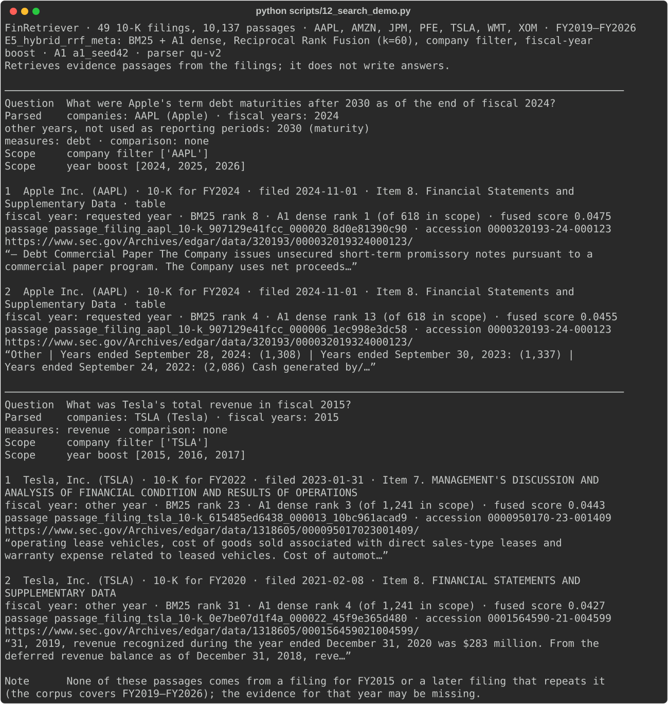

# Search demo

`scripts/12_search_demo.py` takes a financial research question and shows how FinRetriever handles it, step by
step:

- what the parser read from the question;
- how the search was scoped;
- which passages came back, with everything needed to check them against the filing.



*The image is the demo's actual output (`--top-k 2 --chars 150`, the two questions shown), rendered to SVG
unchanged.*

## Setup (from a fresh clone)

| Step | Command | Time and size | Needed for |
|---|---|---|---|
| 1. Install the tested environment | `python3.11 -m venv .venv && source .venv/bin/activate && make install-locked` | A few minutes; about 1 GB with PyTorch | Everything |
| 2. Download the 49 filings, pinned | `SEC_USER_AGENT="Your Name your.email@example.com" make download CORPUS_CONFIG=configs/data/corpus_v1_pinned.yaml` | About 270 MB from SEC EDGAR (the SEC requires a contact in the User-Agent; the downloader keeps to its rate limit) | Everything |
| 3. Build the corpus | `make corpus CORPUS_CONFIG=configs/data/corpus_v1_pinned.yaml`, then `shasum -a 256 data/processed/corpus_v1.jsonl` | Several minutes; 36 MB. The hash must be `ff9dadf37bb9820e…` (rebuilding from the 49 filings reproduced it exactly) | Everything |
| 4a. Run the public demo | `python scripts/12_search_demo.py --config configs/demo/public_bm25.yaml --question "..."` | Seconds | BM25 with the metadata-aware scope (not evaluated) |
| 4b. Add the fine-tuned checkpoints | Place the three selected checkpoints and their `selection.json` under `models/bge_base_ft_v3_a1/` (paths in `configs/experiments/v2_1_year_roles.yaml`). They are not published yet; see [licensing_and_permissions.md](licensing_and_permissions.md) | 1.6 GB | The evaluated default (E5) and every A1 experiment |
| 5. Run the default demo | `python scripts/12_search_demo.py --question "..."` | The first run embeds the corpus (tens of minutes on a laptop CPU) and caches it in `data/cache/`; later runs start in seconds | E5: BM25 + A1, RRF, company filter, fiscal-year boost |

Start step 2 from an empty `data/raw/`. The demo checks the corpus hash and each checkpoint's selection record. If
something is missing, it says what is missing and how to get it.

## Usage

```bash
python scripts/12_search_demo.py --question "How much long-term debt did Walmart report at the end of fiscal 2023?"
python scripts/12_search_demo.py                         # interactive: one question per line, empty line to quit
python scripts/12_search_demo.py --json --question "..."  # one JSON object per question (trace, hits, explanations)
python scripts/12_search_demo.py --experiment E7_combined --seed a1_seed1337 --question "..."
```

| Option | Default | Meaning |
|---|---|---|
| `--config` | `configs/experiments/v2_1_year_roles.yaml` | Any v2 experiment config, or `configs/demo/public_bm25.yaml` (no checkpoints) |
| `--experiment` | `E5_hybrid_rrf_meta` if the config has it, else the config's first experiment | The retriever: E5 is BM25 + A1 fused by RRF, company filter, fiscal-year boost |
| `--seed` | `a1_seed42` | Which of the three A1 checkpoints (ignored without them) |
| `--top-k`, `--chars` | 5, 240 | Passages shown, and characters of each passage's text |

The demo makes no network request. It writes nothing except the dense embedding cache on the first run with a
new checkpoint.

## What it shows, for each question

| Requirement | How the demo meets it |
|---|---|
| Accept a financial research question | `--question` (repeatable) or interactive input |
| Extract company and fiscal-year metadata | The **Parsed** lines: companies, with the words that matched; fiscal (reporting) years; other years with their role (target, maturity, historical, incidental), which are not used for the search; measures; comparison type |
| Run BM25 and dense retrieval | Both run over the passages in scope. Each hit shows its **BM25 rank** and its **A1 dense rank** among those passages, before fusion |
| Combine the rankings | Reciprocal Rank Fusion, with the fiscal-year boost as one more voter. The **fused score** is shown, and the **Scope** lines record each decision and fallback |
| Display the most relevant passages | The top `--top-k`, with the start of each passage's text |
| Show company, filing year and section | Company and ticker, form, the filing's fiscal year, filing date, and the Item and section title. Tables are flagged |
| Provide traceable evidence | Passage ID (stable, in the corpus), SEC accession number, and the filing's folder in the SEC EDGAR archive (built from the CIK and accession number). Whether the passage is from the **requested year**, a **later filing** that repeats it, or **another year** |
| Never invent an answer | It only retrieves. When no passage comes from the requested fiscal year or a later filing that repeats it, it says that the evidence may be missing. When no corpus company is named, it says that all companies were searched |

## Readiness

| Aspect | Status |
|---|---|
| Works end to end | ✅ On the local data, all seven companies and all three seeds. Output is deterministic: the same question gives the same passages |
| Traceability | ✅ Every hit can be found in the corpus (passage ID) and in EDGAR (accession number, archive address) |
| Honesty about missing evidence | ✅ It writes no answer, and states when the requested year is not covered (example 4 below) |
| Retrieval quality | ⚠️ Not established on human-labelled questions (see the README's Limitations). The examples below show the system as it is: in example 1, the first hit is a segment table that has capital expenditures but no long-term debt. The debt passages come second and third |
| Runs from a fresh clone | ⚠️ Partly. After the pinned corpus rebuild (steps 1–3), the public BM25 mode runs. The evaluated default needs the A1 checkpoints, which are not published yet |
| Hosted demo | ❌ None. A small web demo (for example a Hugging Face Space) becomes possible once the checkpoints and corpus can be published |
| Interface | A plain-text CLI, deliberately: one script, no server, and the same information as `--json` for programmatic use |

## Example run

Four questions written for this document (none comes from an evaluation set), with `--top-k 3 --chars 200`,
seed 42:

1. a single company and year;
2. a question that names a debt maturity year;
3. a target year;
4. a fiscal year the corpus does not cover.

```text
FinRetriever · 49 10-K filings, 10,137 passages · AAPL, AMZN, JPM, PFE, TSLA, WMT, XOM · FY2019–FY2026
E5_hybrid_rrf_meta: BM25 + A1 dense, Reciprocal Rank Fusion (k=60), company filter, fiscal-year
boost · A1 a1_seed42 · parser qu-v2
Retrieves evidence passages from the filings; it does not write answers.

────────────────────────────────────────────────────────────────────────────────────────────────────
Question  How much long-term debt did Walmart report at the end of fiscal 2023?
Parsed    companies: WMT (Walmart) · fiscal years: 2023
          measures: debt · comparison: none
Scope     company filter ['WMT']
Scope     year boost [2023, 2024, 2025]

 1  Walmart Inc. (WMT) · 10-K for FY2023 · filed 2023-03-17 · Item 8. FINANCIAL STATEMENTS AND
    SUPPLEMENTARY DATA · table
    fiscal year: requested year · BM25 rank 6 · A1 dense rank 4 (of 1,010 in scope) · fused score 0.0472
    passage passage_filing_wmt_10-k_3bd870054668_000051_1fc215453f12 · accession 0000104169-23-000020
    https://www.sec.gov/Archives/edgar/data/104169/000010416923000020/
    “Depreciation and amortization | Walmart U.S.: 6,561 | Walmart International: 2,633 | Sam's
    Club: 599 | Corporate and support: 1,359 | Consolidated: 11,152 Capital expenditures | Walmart
    U.S.: 6,131 | …”

 2  Walmart Inc. (WMT) · 10-K for FY2023 · filed 2023-03-17 · Item 7. MANAGEMENT'S DISCUSSION AND
    ANALYSIS OF FINANCIAL CONDITION AND RESULTS OF OPERATIONS · table
    fiscal year: requested year · BM25 rank 21 · A1 dense rank 1 (of 1,010 in scope) · fused score 0.0449
    passage passage_filing_wmt_10-k_3bd870054668_000020_80173a63e4f0 · accession 0000104169-23-000020
    https://www.sec.gov/Archives/edgar/data/104169/000010416923000020/
    “of January 31, 2023, we have $2.1 billion of syndicated and fronted letters of credit
    available, of which $1.8 billion was drawn and represents an unrecorded current obligation.
    Long-term Debt The fol…”

 3  Walmart Inc. (WMT) · 10-K for FY2023 · filed 2023-03-17 · Item 7. MANAGEMENT'S DISCUSSION AND
    ANALYSIS OF FINANCIAL CONDITION AND RESULTS OF OPERATIONS · table
    fiscal year: requested year · BM25 rank 2 · A1 dense rank 23 (of 1,010 in scope) · fused score 0.0441
    passage passage_filing_wmt_10-k_3bd870054668_000019_2d11d7044b8e · accession 0000104169-23-000020
    https://www.sec.gov/Archives/edgar/data/104169/000010416923000020/
    “of long-term debt and related payment of premiums for the early extinguishment of certain notes
    in the prior fiscal period, partially offset by the equity funding from the sale of subsidiary
    stock in …”

────────────────────────────────────────────────────────────────────────────────────────────────────
Question  What were Apple's term debt maturities after 2030 as of the end of fiscal 2024?
Parsed    companies: AAPL (Apple) · fiscal years: 2024
          other years, not used as reporting periods: 2030 (maturity)
          measures: debt · comparison: none
Scope     company filter ['AAPL']
Scope     year boost [2024, 2025, 2026]

 1  Apple Inc. (AAPL) · 10-K for FY2024 · filed 2024-11-01 · Item 8. Financial Statements and
    Supplementary Data · table
    fiscal year: requested year · BM25 rank 8 · A1 dense rank 1 (of 618 in scope) · fused score 0.0475
    passage passage_filing_aapl_10-k_907129e41fcc_000020_8d0e81390c90 · accession 0000320193-24-000123
    https://www.sec.gov/Archives/edgar/data/320193/000032019324000123/
    “– Debt Commercial Paper The Company issues unsecured short-term promissory notes pursuant to a
    commercial paper program. The Company uses net proceeds from the commercial paper program for
    general cor…”

 2  Apple Inc. (AAPL) · 10-K for FY2024 · filed 2024-11-01 · Item 8. Financial Statements and
    Supplementary Data · table
    fiscal year: requested year · BM25 rank 4 · A1 dense rank 13 (of 618 in scope) · fused score 0.0455
    passage passage_filing_aapl_10-k_907129e41fcc_000006_1ec998e3dc58 · accession 0000320193-24-000123
    https://www.sec.gov/Archives/edgar/data/320193/000032019324000123/
    “Other | Years ended September 28, 2024: (1,308) | Years ended September 30, 2023: (1,337) |
    Years ended September 24, 2022: (2,086) Cash generated by/(used in) investing activities | Years
    ended Septe…”

 3  Apple Inc. (AAPL) · 10-K for FY2024 · filed 2024-11-01 · Item 7. Management's Discussion and
    Analysis of Financial Condition and Results of Operations · table
    fiscal year: requested year · BM25 rank 21 · A1 dense rank 7 (of 618 in scope) · fused score 0.0431
    passage passage_filing_aapl_10-k_907129e41fcc_000000_d2d0adc6da2f · accession 0000320193-24-000123
    https://www.sec.gov/Archives/edgar/data/320193/000032019324000123/
    “Item 7. Management's Discussion and Analysis of Financial Condition and Results of Operations
    The following discussion should be read in conjunction with the consolidated financial
    statements and acco…”

────────────────────────────────────────────────────────────────────────────────────────────────────
Question  What are ExxonMobil's 2030 emission reduction targets?
Parsed    companies: XOM (Exxon) · fiscal years: none named
          other years, not used as reporting periods: 2030 (target)
          measures: — · comparison: none
Scope     company filter ['XOM']
Scope     no fiscal year named: no year boost

 1  EXXON MOBIL CORP (XOM) · 10-K for FY2025 · filed 2026-02-18 · BUSINESS ENVIRONMENT
    BM25 rank 1 · A1 dense rank 1 (of 1,358 in scope) · fused score 0.0328
    passage passage_filing_xom_10-k_f28c680b97d1_000006_a384f49dc87e · accession 0000034088-26-000045
    https://www.sec.gov/Archives/edgar/data/34088/000003408826000045/
    “by 2050, with advancements in technology and clear, consistent, stable, and effective
    government policies. Society's progress continues to lag in these areas. Without supportive
    policies and the innov…”

 2  EXXON MOBIL CORP (XOM) · 10-K for FY2021 · filed 2022-02-23 · BUSINESS ENVIRONMENT
    BM25 rank 4 · A1 dense rank 2 (of 1,358 in scope) · fused score 0.0318
    passage passage_filing_xom_10-k_477c09ec7e46_000004_54b1c2db7d32 · accession 0000034088-22-000011
    https://www.sec.gov/Archives/edgar/data/34088/000003408822000011/
    “nations are expected to trail OECD policy initiatives. Nevertheless, as people and nations look
    for ways to reduce risks of global climate change, they will continue to need practical
    solutions that d…”

 3  EXXON MOBIL CORP (XOM) · 10-K for FY2022 · filed 2023-02-22 · BUSINESS ENVIRONMENT
    BM25 rank 2 · A1 dense rank 4 (of 1,358 in scope) · fused score 0.0318
    passage passage_filing_xom_10-k_4af8038e101f_000005_76145585cdf2 · accession 0000034088-23-000020
    https://www.sec.gov/Archives/edgar/data/34088/000003408823000020/
    “proxy cost on energy-related CO2 emissions is assumed, based on regional considerations and
    relative levels of economic development, and by 2050, reaches up to $150 per metric ton for OECD
    nations and…”

────────────────────────────────────────────────────────────────────────────────────────────────────
Question  What was Tesla's total revenue in fiscal 2015?
Parsed    companies: TSLA (Tesla) · fiscal years: 2015
          measures: revenue · comparison: none
Scope     company filter ['TSLA']
Scope     year boost [2015, 2016, 2017]

 1  Tesla, Inc. (TSLA) · 10-K for FY2022 · filed 2023-01-31 · Item 7. MANAGEMENT'S DISCUSSION AND
    ANALYSIS OF FINANCIAL CONDITION AND RESULTS OF OPERATIONS
    fiscal year: other year · BM25 rank 23 · A1 dense rank 3 (of 1,241 in scope) · fused score 0.0443
    passage passage_filing_tsla_10-k_615485ed6438_000013_10bc961acad9 · accession 0000950170-23-001409
    https://www.sec.gov/Archives/edgar/data/1318605/000095017023001409/
    “operating lease vehicles, cost of goods sold associated with direct sales-type leases and
    warranty expense related to leased vehicles. Cost of automotive leasing revenue also includes
    vehicle connecti…”

 2  Tesla, Inc. (TSLA) · 10-K for FY2020 · filed 2021-02-08 · Item 8. FINANCIAL STATEMENTS AND
    SUPPLEMENTARY DATA
    fiscal year: other year · BM25 rank 31 · A1 dense rank 4 (of 1,241 in scope) · fused score 0.0427
    passage passage_filing_tsla_10-k_0e7be07d1f4a_000022_45f9e365d480 · accession 0001564590-21-004599
    https://www.sec.gov/Archives/edgar/data/1318605/000156459021004599/
    “31, 2019, revenue recognized during the year ended December 31, 2020 was $283 million. From the
    deferred revenue balance as of December 31, 2018, revenue recognized during the year ended
    December 31, …”

 3  Tesla, Inc. (TSLA) · 10-K for FY2021 · filed 2022-02-07 · Item 8. FINANCIAL STATEMENTS AND
    SUPPLEMENTARY DATA · table
    fiscal year: other year · BM25 rank 26 · A1 dense rank 11 (of 1,241 in scope) · fused score 0.0416
    passage passage_filing_tsla_10-k_5a2b9655d6e3_000019_0f94ba90b173 · accession 0000950170-22-000796
    https://www.sec.gov/Archives/edgar/data/1318605/000095017022000796/
    “Deferred revenue on automotive sales with and without resale value guarantee— end of period |
    Year ended December 31, 2021: $2,382 | Year ended December 31, 2020: $1,926 [/TABLE] Deferred
    revenue is e…”

Note      None of these passages comes from a filing for FY2015 or a later filing that repeats it
          (the corpus covers FY2019–FY2026); the evidence for that year may be missing.
```
